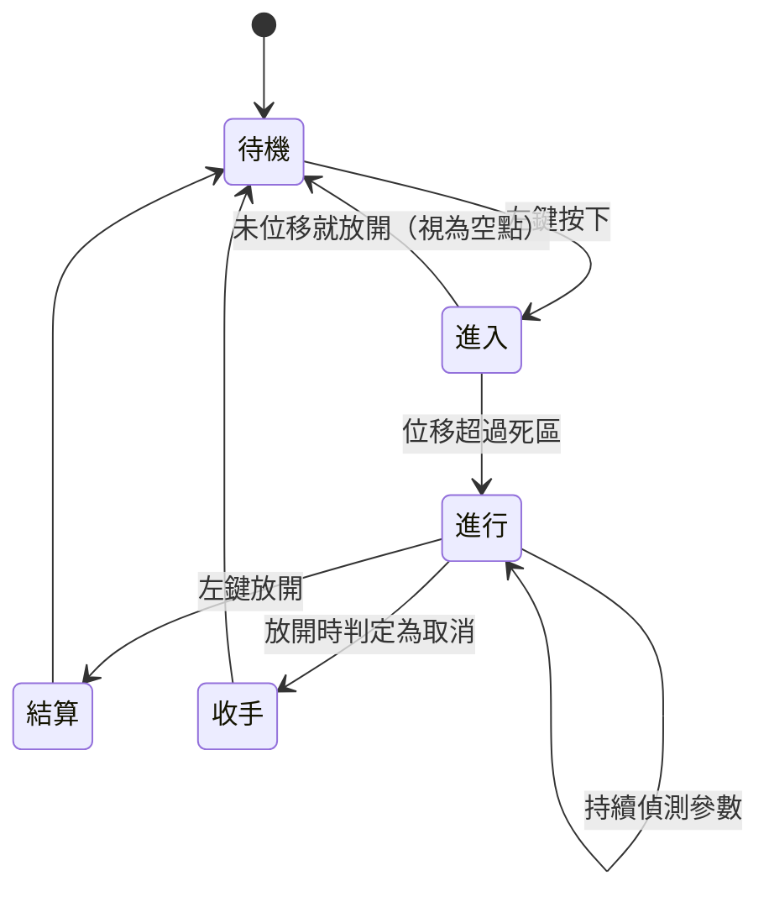
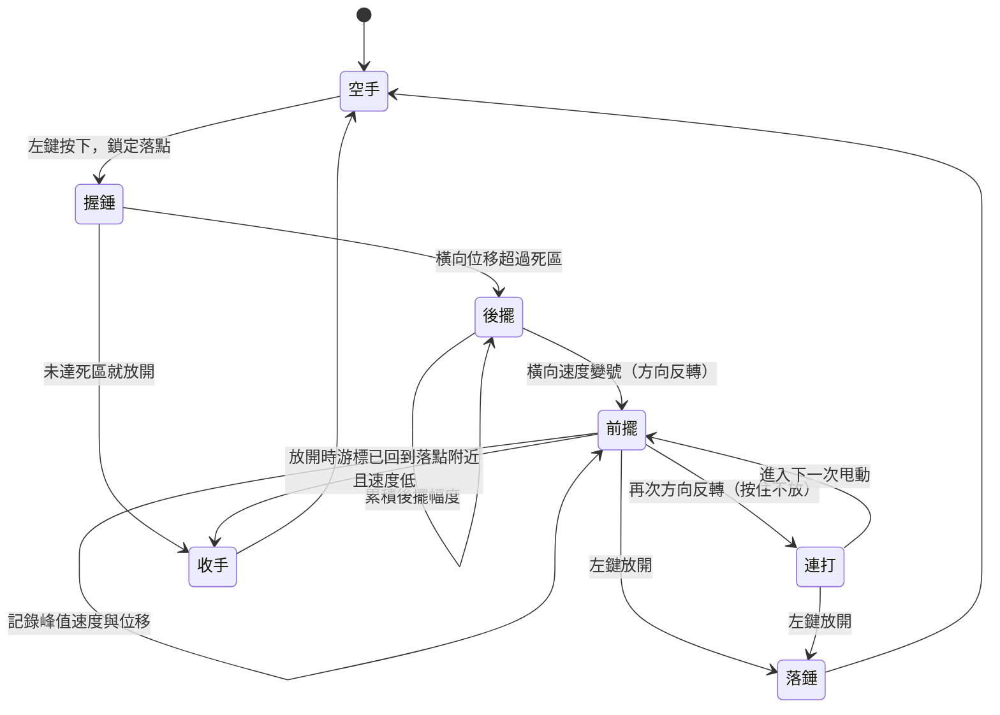

# 輸入狀態機與動作文法

> 建立日期：2026-10-28
> 類型：功能規劃
> 狀態：規劃中
> 影響範圍：輸入系統、核心手感、所有工序

---

## 這份文件要幹嘛

[[02_操作轉化設計]] 定義了八個滑鼠動詞，但只描述了手勢的長相，沒有定義它的狀態機。一個動作從哪裡算開始、過程中偵測什麼、到哪裡算結束、結算取哪一刻的值，這些沒定清楚，實作時每一步都會卡住。

這份文件補上那一層。先定一套所有動詞共用的文法，再把最核心的「揮」寫成完整規格，最後把三個真正有分歧的點列出來評估。

---

## 一、共通文法：所有動作都是三段式

每一個滑鼠動詞都走同一條路，差別只在中間那段偵測什麼。這樣玩家只要建立一次肌肉記憶。

三段各自的職責：

| 段 | 訊號 | 職責 |
|---|---|---|
| **進入** | 左鍵按下 | 宣告動作開始、**鎖定目標位置**、角色擺出姿勢、畫面給出預覽 |
| **進行** | 按住期間的移動 | 累積這個動詞的參數（幅度、速度、覆蓋、抖動） |
| **結算** | 左鍵放開 | 結束動作、把累積的參數換算成對工件的影響 |

三個設計上的決定：

1. **按下的那一刻就鎖定目標位置。** 這是整套文法的關鍵。瞄準跟出力分成兩件事，玩家才有辦法兩個都調。如果目標要等放開才決定，力道大小會連帶把目標推開，兩者耦合就調不動了
2. **放開一定要有意義。** 它不只是「手放開」，它是結算的訊號。沒有放開，動作就沒結束
3. **要留收手的餘地。** 按下去之後發現不對，應該能取消。真實鐵匠舉起錘子也可以放下來不打

---

## 二、「揮」的完整狀態機

### 2.1 為什麼甩動軸是左右

原本寫的是上下甩動，改掉。

滑鼠在桌面上做上下移動（也就是推拉滑鼠），靠的是前臂整段動，滑鼠墊的前後空間也有限。左右甩動靠手腕轉，快、省力、空間大。一局遊戲要揮幾百上千次，這個差別會直接變成手痠不痠。

代價是**畫面上錘子的弧線是上下的，手的動作卻是左右的**。這個不一致要用一條規則解決：

> **游標不是錘子。** 游標是瞄準與施力的輸入，錘子的弧線是演出。錘頭不跟隨游標，它照自己的動畫軌跡落到被鎖定的目標點上。

錘子的動畫節奏由玩家的甩動驅動（甩得快，揮錘動畫就快），但軌跡不由游標決定。這樣左右甩動可以產生上下揮錘的畫面，而且錘頭永遠落在該落的地方，不會因為游標飄走而視覺上錯位。

### 2.2 狀態機

### 2.3 各狀態做什麼

| 狀態 | 進入條件 | 期間偵測 | 畫面回饋 |
|---|---|---|---|
| **握錘** | 左鍵按下 | 記下按下座標當作落點 | 工件上出現落點十字標記，角色舉錘待命 |
| **後擺** | 橫向位移超過死區（畫面寬度 1.5%） | 累積後擺總幅度，決定這一錘的力道上限 | 錘子跟著舉高，高度對應幅度；超過上限時標記變色提醒 |
| **前擺** | 橫向速度變號 | 記錄峰值速度、總位移、垂直方向的抖動量 | 錘子開始下落動畫，速度對應甩動速度 |
| **落錘** | 左鍵放開 | 結算 | 撞擊、火花、工件變形、顏色變暗 |
| **收手** | 放開時游標已回到落點附近且當前速度低於門檻 | 不結算 | 錘子放下，不消耗熱度，不改變工件 |
| **連打** | 按住不放再次方向反轉 | 每次反轉算一錘 | 見第五節 |

### 2.4 參數怎麼算

| 參數 | 取自 | 說明 |
|---|---|---|
| 落點 | 按下座標 + 偏移向量 | 偏移見下一列 |
| 落點偏移 | 前擺期間的垂直抖動量 + 超出上限的過量幅度 + 技藝決定的基礎隨機半徑 | 甩得越亂、越用力過頭，打得越偏 |
| 力道上限 | 後擺總幅度，到畫面寬度 25% 封頂 | 封頂是為了防止玩家無限狂甩 |
| 實際力道 | 前擺的峰值速度，上限由後擺幅度壓著 | 舉得不高就打不重，舉得高也可以輕輕打 |
| 錘面傾角 | 前擺終點相對落點的水平位移方向與距離 | 停在落點正上方＝正面壓薄；越過落點＝斜打，金屬往那個方向流 |
| 節奏 | 與前一次落錘的間隔 | 間隔穩定進入順手狀態，效率提高 |

**全部用畫面比例計算，不用像素。** 力道判定寫成「橫向位移佔畫面寬度的百分比」，這樣不同解析度與不同 DPI 的玩家手感才會一致。

### 2.5 偵測細節

這幾個數字是給實作當起點用的，實際要靠手感調。

| 項目 | 起點值 | 理由 |
|---|---|---|
| 取樣 | 每幀記錄游標座標，保留最近 200 毫秒的環形緩衝 | 夠算峰值速度，記憶體負擔小 |
| 速度計算 | 最近 3 幀的位移平均，避免單幀抖動 | 單幀差分雜訊太大 |
| 死區 | 畫面寬度的 1.5% | 低於這個當作手抖，不觸發後擺 |
| 方向反轉判定 | 橫向速度符號改變，且反向累積位移超過死區 | 只看符號會在速度過零時誤判 |
| 力道取樣窗 | 放開前 120 毫秒內的峰值速度 | 放開那一瞬間速度通常已經降下來了 |
| 收手判定 | 放開時游標距落點小於畫面寬度 3%，且當前速度低於死區速度 | 甩回原點等於把錘子放下 |
| 後擺幅度封頂 | 畫面寬度 25% | 超過不再增加力道，但會開始累積落點偏移 |

---

## 三、三個要實測評估的分歧

這三個都是「紙上推不出來、要做出來甩甩看」的題目。每題給建議方案與怎麼測。

### 分歧一：落點取按下的位置還是放開的位置

| | 取按下位置 | 取放開位置 | **混合（建議）** |
|---|---|---|---|
| 瞄準與出力 | 分離，兩個都可控 | 耦合，甩得猛就打得遠 | 分離，但甩得亂會偏 |
| 直覺 | 要先學「先瞄再甩」 | 放開即落下，很直覺 | 同按下位置 |
| 精準度天花板 | 高，但跟技術無關 | 低，而且難練 | 高，由玩家的手決定 |
| 技藝成長 | 只能靠系統縮小隨機偏移 | 玩家自己練甩動 | 偏移量由軌跡乾淨度決定，練得到 |

**建議混合**：落點 = 按下座標 + 偏移，偏移量由前擺的垂直抖動與過量幅度決定。

理由是，完全取按下位置的話甩動就只剩下加力的功能，「手穩不穩」沒有發揮空間；完全取放開位置的話，力道一大落點就必然飄，玩家練不起來。混合讓「又重又準」變成一件要練的事，而這正是鐵匠的手藝。

**怎麼測**：對同一個目標點連打 20 次，畫落點散布圖。取按下位置會是一個緊的圓；取放開位置會是一條沿甩動方向的長橢圓；混合應該是一個隨力道變大而變大的圓。如果混合方案在輕打時散布收不緊，代表偏移係數給太大。

### 分歧二：什麼時候算落錘

| | 放開即落錘 | 偵測到減速就落錘 | **放開結算、力道取峰值（建議）** |
|---|---|---|---|
| 結束訊號是否明確 | 明確 | 不明確，玩家不知道這一錘什麼時候結束 | 明確 |
| 能不能收手 | 不能 | 不能 | 能 |
| 力道取樣穩定度 | 差，放開瞬間速度常常已經降了 | 好 | 好 |
| 連打流暢度 | 要不斷按下放開，手指會累 | 流暢 | 兩種模式都支援（見第五節） |

**建議**：放開才結算，力道取放開前 120 毫秒內的峰值速度，並且支援收手。

「偵測到減速就落錘」在物理上最像真的（錘子碰到工件就停了），但它把結束訊號從玩家手上拿走，玩家會不確定自己這一錘到底算不算打出去了。你原本的判斷是對的，結束要由放開來宣告。

**怎麼測**：讓玩家做十次「舉起來但不想打」的動作，看能不能可靠地收手。如果收手判定太難觸發，玩家會覺得被強迫出手。

### 分歧三：要不要配合敲打時機

**建議不要做成必須對拍的判定，但保留節奏的獎勵。**

理由在 [[02_操作轉化設計]] 原則 1：這個遊戲的難處不該是反應測驗。做法是，與前一錘的間隔穩定時進入順手狀態，變形效率提高；間隔不穩定沒有加成，但也不扣分。節奏是獎勵，不是門檻。

這樣做還有一個好處：玩家在粗胚階段會自然地打出穩定的快節奏（因為有加成），在修形階段會自然慢下來一錘一錘打（因為要精準），節奏變化是從目的長出來的，不是被譜面規定的。

**怎麼測**：看玩家在不同階段的實際敲打間隔分布。如果不管做什麼都打成同一個節奏，代表加成給得太重或太輕。

---

## 四、按住期間畫面要給什麼

狀態機每一段都要有對應的回饋，否則玩家不知道自己在哪一段。

| 狀態 | 回饋 |
|---|---|
| 握錘 | 工件上一個落點十字標記。這是「我瞄在這裡」的確認 |
| 後擺 | 錘子舉高，高度跟著幅度長。接近封頂時標記邊緣泛黃，超過封頂轉紅並開始出現抖動圈 |
| 前擺 | 錘子下落動畫，速度跟著甩動速度。落點標記旁出現一個小箭頭表示錘面傾角與金屬流向 |
| 落錘 | 撞擊音、火花、工件該處即時變形、整體顏色變暗一階 |
| 收手 | 錘子放下的動畫，標記消失，沒有任何聲音與變化 |

抖動圈那個設計值得特別留著：它把「我現在打下去會偏多少」變成看得見的東西，玩家就能自己決定要不要為了力道冒偏掉的風險。

---

## 五、連打模式

你提到「之後再開始下一輪」。這裡有個選擇：下一錘要不要重新按下。

兩個都要，而且**切換方式就是要不要放開**，不需要額外按鍵：

| 模式 | 操作 | 特性 | 什麼時候用 |
|---|---|---|---|
| **單擊** | 按下、甩、放開，一錘 | 每一錘都有獨立的瞄準與收手機會，精準 | 修形、鉚接、接近完成時 |
| **連打** | 按住不放，持續左右來回甩，每次方向反轉算一錘 | 手指不累、節奏流暢，但落點偏移累積放大 | 粗胚、延展、要快速吃掉大量變形時 |

連打模式的落點處理：第一次按下鎖定的落點當基準，之後每一錘的偏移逐次累加一點，連打越久飄得越開。想重新瞄準就放開再按一次。

這對應真實鐵匠的工作方式：粗胚時快速連打不求精準，修形時一錘一錘慢慢來。玩家會自己在兩種模式間切換，不需要教。

---

## 六、把文法套回其他七個動詞

同一套三段式，每個動詞只換中間偵測什麼。這張表是檢查文法成不成立的依據。

| 動詞 | 按下＝ | 進行期間偵測 | 放開＝ | 有沒有收手 |
|---|---|---|---|---|
| **揮** | 鎖定落點、握錘 | 後擺幅度、前擺峰值速度、終點偏移、抖動 | 落錘結算 | 有（甩回原點） |
| **推** | 貼上磨石、鎖定起始段 | 來回行程、速度、落點漂移、停頓時間、右鍵加壓 | 離開磨石，結算磨除量與生熱 | 無，隨時可放開 |
| **刷** | 沾料下筆 | 覆蓋軌跡、速度、右鍵厚度 | 收筆，結算覆蓋率與厚度分布 | 無 |
| **拖** | 夾住、鎖定入液起點 | 軌跡與垂直線夾角、速度變異、停頓 | 鬆手（通常已在液中），結算變形與裂紋 | 有（入液前拉回） |
| **繞** | 鎖定螺旋起點（中心或外緣） | 半徑推進速度、每圈落點間距 | 結束這一輪成形 | 無 |
| **描** | 起筆 | 抖動量、是否斷線、速度一致性 | 收筆。中途離開路徑＝斷線＝失敗 | 有（原路退回起點） |
| **持** | 開始加熱／灌注 | 位置微調、累積量 | **停手。這個動詞的全部意義在這裡** | 無，放開就是結果 |
| **檢** | 右鍵按下 | 無 | 右鍵放開即完成，顯示檢查結果 | 無 |

「持」跟「揮」剛好是兩個極端：「揮」的重點在進行期間怎麼甩，放開只是宣告結束；「持」的進行期間幾乎不做事，全部的勝負在放開那一刻。八個動詞排在這條光譜上，玩家會逐漸體會到「這個工序考的是過程還是考時機」。

---

## 七、還沒決定的事

- 單擊與連打之間，系統要不要給玩家任何提示，還是讓玩家自己發現
- 連打的偏移累積速度要多快。太快玩家不敢連打，太慢就沒有理由用單擊
- 錘子動畫的長度要不要跟甩動速度完全綁定。完全綁定的話超快連打會讓動畫破圖
- 左右甩動與「推」的手部動作幾乎相同，只靠所在位置區分。要實測確認玩家不會混淆
- 收手要不要消耗一點時間（角色把錘子放下的動畫），還是可以瞬間接下一錘
